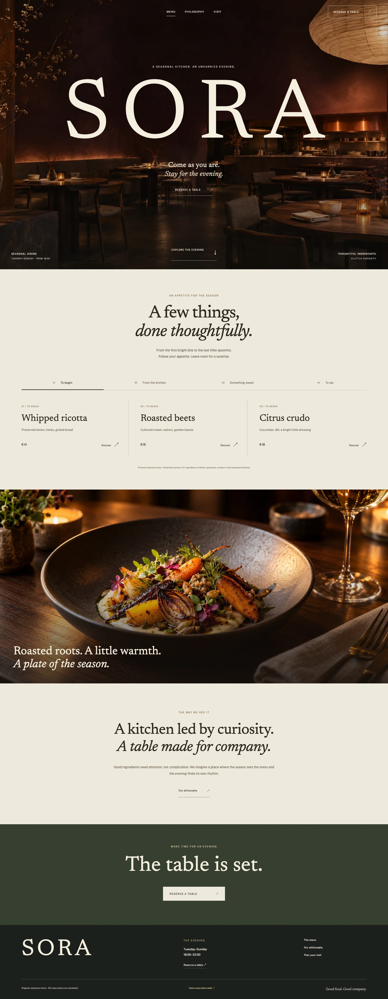

# Sora

A seasonal restaurant experience with a working local reservation desk. Original fictional brand, built November 2026 with Angular 22 and strict TypeScript.



An atmospheric dining-room opening, an oversized Newsreader wordmark, horizontal course discovery and a restaurant booking folio give Sora its own visual rhythm. Public Sans handles the interface. All primary controls are real; reservations remain a local simulation.

## Explore

- Ten illustrative dishes across four categories, with keyboard-accessible details and a mobile course rail.
- A complete date/party/time → contact → review → confirmation flow, using typed reactive forms.
- Deterministic loading, closed/full evenings and failure/retry states.
- A clearly identified demo reservation desk with list/calendar views, search/date/status filters, editing, cancellation and reset.
- Versioned local reservation persistence with corrupt/denied-storage recovery. Contact names and emails stay in memory; the desk stores generated guest labels.
- Keyboard focus management, reduced-motion support, responsive layouts and deliberately handled missing routes.

**[Open the verified live demo](https://khalilbenali1.github.io/sora-angular/)** · [Source repository](https://github.com/khalilBenAli1/sora-angular)

The public deployment, direct routes and complete reservation/management journey have been verified. No real restaurant, payment, email or authentication service is connected.

## Run

Use Node 22.23.1 and npm 10.9.8. The project-level npm policy preserves strict peer resolution.

```sh
npm ci
npm run dev
```

```sh
npm run lint
npm run format:check
npm run typecheck
npm test
npm run build
npm run preview
npx playwright install chromium webkit
npm run test:e2e
```

Production preview: `http://127.0.0.1:4180/sora-angular/`. The production build is in `dist/sora-angular/browser`.

## Try the full flow

Choose an evening and seating, then use sample details and acknowledge the simulation. The resulting reservation appears in the demo desk, where you can edit or cancel it. **Reset demo data** restores four fictional sample records. Mondays show the closed-kitchen state; the 17th demonstrates no availability; the 13th demonstrates a recoverable connection failure.

Reservations and synthetic guest labels are stored on this browser only. Contact fields are never written to localStorage or sent anywhere. No card details are requested.

See [architecture and state ownership](docs/ARCHITECTURE.md), [asset provenance](ASSETS.md), [font licenses](public/FONT_LICENSES.txt) and the [implementation plan](IMPLEMENTATION_PLAN.md). Original code is MIT; third-party font licenses remain separate.
